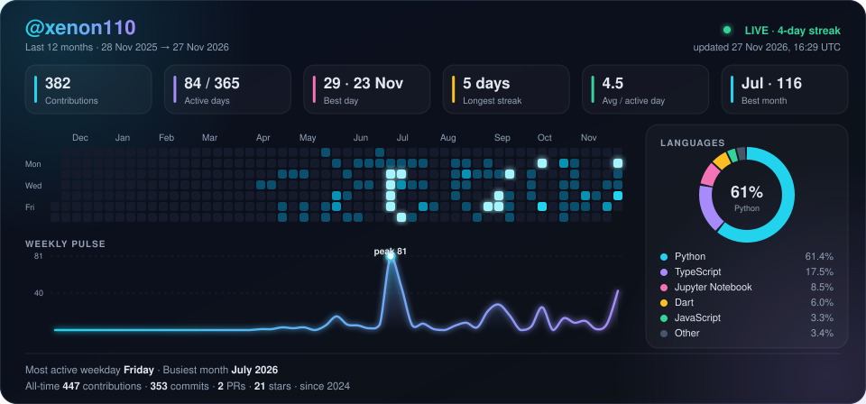
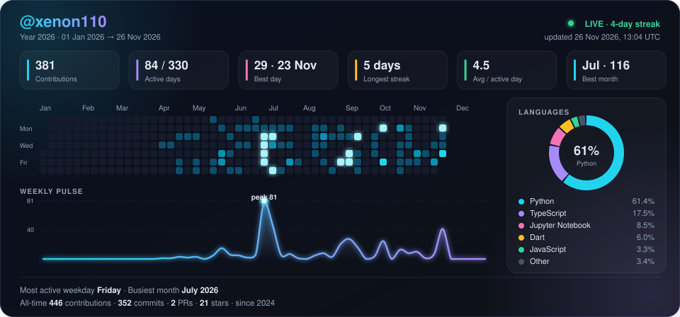
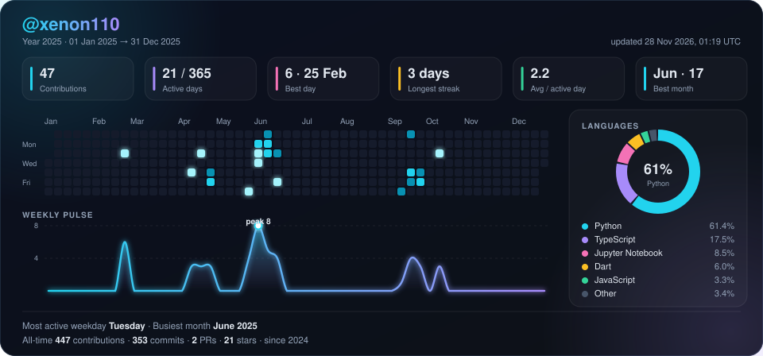
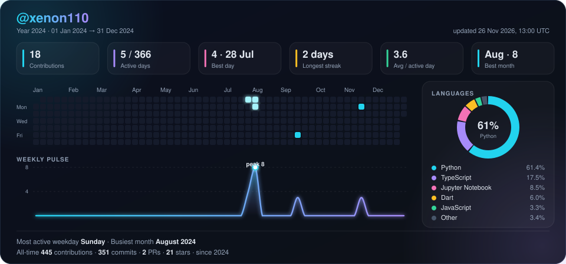

<div align="center" id="top">


<br/>

<a href="https://mayank-portfolio-indol.vercel.app/"></a>
<a href="https://www.linkedin.com/in/mayank-raj-b8b312272/"></a>
<a href="mailto:mayankrajdto@gmail.com"></a>
<a href="https://drive.google.com/file/d/1udg0oY2RuPLh2rD2_bMb9wX_DeoL8MvX/view?usp=sharing"></a>


</div>

<br/>

## 👋 About

```python
class Mayank:
    role     = ["Data Scientist", "AI/ML Engineer", "Software Developer"]
    focus    = ["Deep Learning", "NLP & LLMs", "Computer Vision", "MLOps on the Cloud"]
    mindset  = "Curious mind. Practical code. Continuous improvement."
    ships    = "models → APIs → containers → cloud"
```

## 🧰 Stack

<table>
<tr>
<td><b>Languages & Web</b></td>
<td></td>
</tr>
<tr>
<td><b>Data & ML</b></td>
<td></td>
</tr>
<tr>
<td><b>Cloud & Data</b></td>
<td></td>
</tr>
<tr>
<td><b>Exploring</b></td>
<td><code>Kubernetes</code> · <code>Terraform</code> · <code>GCP / Azure</code> · <code>MLflow</code></td>
</tr>
</table>

## 📈 Activity — live

<div align="center">


&nbsp;


</div>

> Rebuilt from real GitHub history every 6 hours — heatmap per day, weekly pulse, language breakdown, and key numbers. Click any year to expand it. Open the SVG directly to **hover over individual days**.

<div align="center">

</div>

<details open>
<summary><b>📅 Browse by year</b> — click any year to expand its full heatmap</summary>

<!--START_SECTION:years-->
<details><summary><b>2026</b> — 380 contributions</summary><br/></details>
<details><summary><b>2025</b> — 47 contributions</summary><br/></details>
<details><summary><b>2024</b> — 18 contributions</summary><br/></details>
<!--END_SECTION:years-->

</details>

## 🚀 Featured Projects

<table>
<tr>
<td width="50%" valign="top">
<h3>🩺 MediSkin</h3>
<p>AI-powered skin disease analysis using deep learning and computer vision. Classifies 20+ conditions with confidence scores.</p>


[](https://github.com/xenon110/Mediskin)

</td>
<td width="50%" valign="top">
<h3>📬 Veyra</h3>
<p>Intelligent email analytics using NLP and large language models. Summarises, categorises and surfaces insights from your inbox.</p>


[](https://github.com/xenon110?tab=repositories)

</td>
</tr>
<tr>
<td width="50%" valign="top">
<h3>🗂️ Task Management</h3>
<p>Data-driven task, attendance and operational workflows. Full-stack system built for real teams.</p>


[](https://github.com/xenon110?tab=repositories)

</td>
<td width="50%" valign="top">
<h3>🍽️ Scan2Eat</h3>
<p>AI-powered food analysis and nutrition insights. Scan any meal and get instant breakdown of macros and calories.</p>


[](https://github.com/xenon110?tab=repositories)

</td>
</tr>
</table>

<div align="center">

[](https://github.com/xenon110?tab=repositories)

</div>

## 🔥 Recently active (auto-updated)

<!--START_SECTION:repos-->
<table><tr><th>Repository</th><th>About</th><th>Language</th><th>Stars</th><th>Last push</th></tr><tr><td><a href="https://github.com/xenon110/Mission-27"><b>Mission-27</b></a></td><td>—</td><td><code>C++</code></td><td>⭐ 0</td><td>2026-11-26</td></tr><tr><td><a href="https://github.com/xenon110/My_portfolio"><b>My_portfolio</b></a></td><td>My portfolio</td><td><code>JavaScript</code></td><td>⭐ 1</td><td>2026-11-20</td></tr><tr><td><a href="https://github.com/xenon110/Bhoomi"><b>Bhoomi</b></a></td><td>—</td><td><code>Dart</code></td><td>⭐ 0</td><td>2026-11-12</td></tr><tr><td><a href="https://github.com/xenon110/Task_Management_BKM"><b>Task_Management_BKM</b></a></td><td>—</td><td><code>TypeScript</code></td><td>⭐ 0</td><td>2026-10-30</td></tr><tr><td><a href="https://github.com/xenon110/Creatorly"><b>Creatorly</b></a></td><td>—</td><td><code>TypeScript</code></td><td>⭐ 0</td><td>2026-10-23</td></tr><tr><td><a href="https://github.com/xenon110/Devpost-Retail-Hackthon"><b>Devpost-Retail-Hackthon</b></a></td><td>—</td><td><code>Python</code></td><td>⭐ 0</td><td>2026-10-09</td></tr></table>
<!--END_SECTION:repos-->

## 🌐 Elsewhere

<div align="center">

<a href="https://github.com/xenon110?tab=repositories"></a>
<a href="https://leetcode.com/u/mayank103/"></a>
<a href="https://www.kaggle.com/raj110"></a>
<a href="https://www.geeksforgeeks.org/profile/rmayan29z6?tab=activity"></a>
<a href="https://takeuforward.org/profile/Mayank10"></a>

<br/><br/>

**Less talking. More building. Better every commit.**

<!--START_SECTION:updated-->
<sub>🤖 auto-generated · last refresh 26 Nov 2026, 13:00 UTC</sub>
<!--END_SECTION:updated-->

<a href="#top">⬆ back to top</a>


</div>
