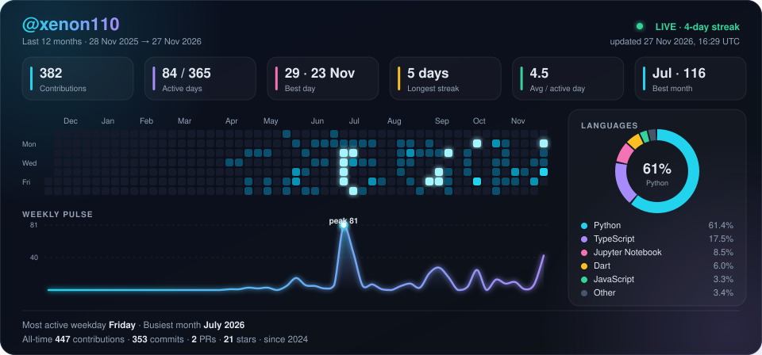
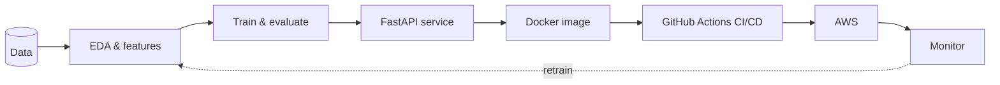

<div align="center" id="top">


<br/>

<a href="https://mayank-portfolio-indol.vercel.app/"></a>
<a href="https://www.linkedin.com/in/mayank-raj-b8b312272/"></a>
<a href="mailto:mayankrajdto@gmail.com"></a>
<a href="https://drive.google.com/file/d/1udg0oY2RuPLh2rD2_bMb9wX_DeoL8MvX/view?usp=sharing"></a>


</div>

<br/>

## 👋 About

```python
class Mayank:
    role     = ["Data Scientist", "AI/ML Engineer", "Software Developer"]
    focus    = ["Deep Learning", "NLP & LLMs", "Computer Vision", "MLOps on the Cloud"]
    mindset  = "Curious mind. Practical code. Continuous improvement."
    ships    = "models → APIs → containers → cloud"
```

## 🧰 Stack

<table>
<tr>
<td><b>Languages & Web</b></td>
<td></td>
</tr>
<tr>
<td><b>Data & ML</b></td>
<td></td>
</tr>
<tr>
<td><b>Cloud & Data</b></td>
<td></td>
</tr>
<tr>
<td><b>Exploring</b></td>
<td><code>Kubernetes</code> · <code>Terraform</code> · <code>GCP / Azure</code> · <code>MLflow</code></td>
</tr>
</table>

## 📈 Activity — live

<sub>One dashboard, rebuilt from my real GitHub history every 6 hours by a GitHub Action: heatmap (every day), weekly trend (same time axis), languages and key numbers. Open an SVG directly to hover over any day.</sub>

<div align="center">

</div>

**Browse any year (month → day):**

<!--START_SECTION:years-->
<!--END_SECTION:years-->

## 🚀 Featured projects

<table>
<tr>
<td width="50%" valign="top">

### 🩺 MediSkin
AI-powered skin disease analysis using deep learning and computer vision.

`Python` `TensorFlow` `React`

[View project →](https://github.com/xenon110/Mediskin)

</td>
<td width="50%" valign="top">

### 📬 Veyra
Intelligent email analytics using NLP and large language models.

`Python` `FastAPI` `Gemini` `Supabase`

[View on GitHub →](https://github.com/xenon110?tab=repositories)

</td>
</tr>
<tr>
<td width="50%" valign="top">

### 🗂️ Task Management
Data-driven task, attendance and operational workflows.

`React` `Node.js` `PostgreSQL`

[View on GitHub →](https://github.com/xenon110?tab=repositories)

</td>
<td width="50%" valign="top">

### 🍽️ Scan2Eat
AI-powered food analysis and nutrition insights.

`Python` `OpenCV` `Machine Learning`

[View on GitHub →](https://github.com/xenon110?tab=repositories)

</td>
</tr>
</table>

## ☁️ How I ship ML



## 🔥 Recently active (auto-updated)

<!--START_SECTION:repos-->
<!--END_SECTION:repos-->

## 🌐 Elsewhere

<div align="center">

<a href="https://github.com/xenon110?tab=repositories"></a>
<a href="https://leetcode.com/u/mayank103/"></a>
<a href="https://www.kaggle.com/raj110"></a>
<a href="https://www.geeksforgeeks.org/profile/rmayan29z6?tab=activity"></a>
<a href="https://takeuforward.org/profile/Mayank10"></a>

<br/><br/>

**Less talking. More building. Better every commit.**

<!--START_SECTION:updated-->
<!--END_SECTION:updated-->

<a href="#top">⬆ back to top</a>


</div>
